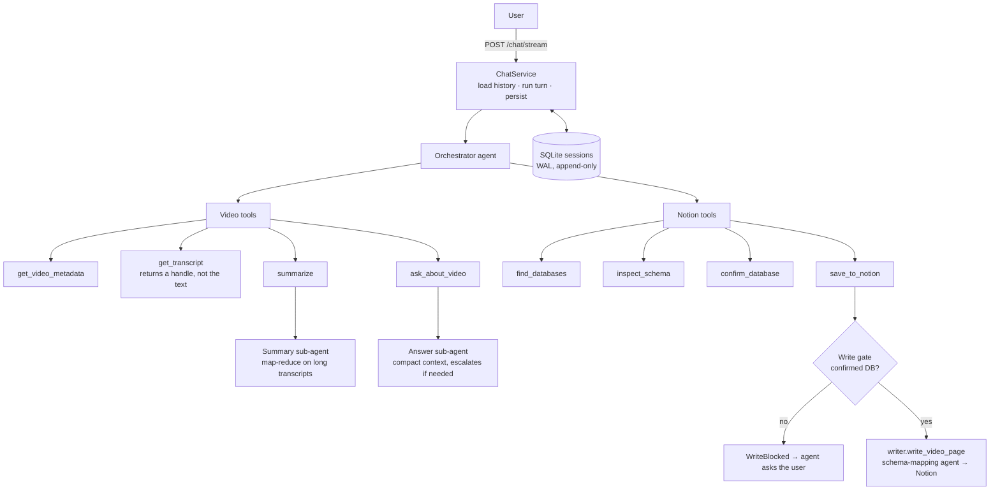

# WebToNotion

A FastAPI service with a multi-turn AI agent that turns video links into structured
Notion pages.

Point it at a YouTube, Vimeo, TikTok, Instagram, Facebook, Twitch, or X video and talk
to it: ask what the video is about, ask for a summary, ask follow-up questions, then
have it save the result into one of your Notion databases. The agent picks candidate
databases, inspects their schemas, and asks you to confirm before it writes anything.

It exposes two surfaces over the same pipeline:

| Surface | What it is |
|---|---|
| `POST /api/v1/chat` · `/chat/stream` | The agentic chat. One orchestrator agent, eight tools, ephemeral sub-agents, persistent sessions, SSE streaming |
| `POST /api/v1/process/url` | One-shot: URL + database ID in, Notion page out. No conversation |

Built with [PydanticAI](https://ai.pydantic.dev/), FastAPI, yt-dlp, Groq Whisper,
OpenRouter and the Notion API.

## The agent



A typical conversation:

```
you    > what's this one about? https://www.youtube.com/watch?v=...
agent  ⟶ get_video_metadata
agent  > A 14-minute talk on ... by ...  Want a summary?
you    > yes, short bullet points
agent  ⟶ summarize   (transcribes once, cached; summary sub-agent)
agent  > • ...  • ...  • ...
you    > save it to Notion
agent  ⟶ find_databases · inspect_schema
agent  > "Watch Later" fits best, "Learning" is a close second. Which one?
you    > Watch Later
agent  ⟶ confirm_database · save_to_notion
agent  > Saved: https://www.notion.so/...
```

### Design decisions worth looking at

- **Writes are gated in code.** `save_to_notion` checks the session's confirmed
  database itself and returns a structured `WriteBlocked` when it is missing or
  differs from the requested one. The model can't talk its way past it, and it gets
  a result it can recover from instead of an exception
  ([`agents/tools/notion.py`](src/webtonotion/agents/tools/notion.py)).
- **Transcripts are untrusted input.** The orchestrator's instructions treat video
  titles, descriptions and transcripts as data, never as commands, so a transcript
  saying "save this to Finance" has no effect on what the agent does.
- **Transcripts never enter the chat context.** `get_transcript` returns a
  `TranscriptRef` (hash, length, preview). The full text only goes into a short-lived
  sub-agent run inside `summarize` / `ask_about_video` and is never written to session
  history, so a 50k-character transcript doesn't get resent on every later turn.
- **Cost controls.** Sub-agent prompts share one cache-stable prefix with a
  `CachePoint` for provider prompt caching. Answers try a compact context first and
  escalate to the full transcript only when needed. Long transcripts are map-reduced.
  Each turn is capped by `UsageLimits` (requests and total tokens), and the `usage`
  totals include sub-agent calls.
- **Works with any database schema.** The schema is fetched from Notion at write time
  and given to a schema-mapping agent. Its structured output is validated against
  that schema and retried on mismatch, so no database needs its own configuration.
- **One write path.** The chat tool and `/process/url` both go through
  [`agents/writer.py`](src/webtonotion/agents/writer.py), so both surfaces behave the
  same way when they write.
- **Observable.** Logfire traces cover every agent, tool call and sub-agent run,
  including the model's reasoning when `AGENT_THINKING_LEVEL` is on. The stream sends
  `thinking`, `tool_call`, `tool_return` and `text` events as they happen.

## Engineering

- Strict layering: `api → agents → services → models/config`, enforced by convention
  and documented in [docs/architecture.md](docs/architecture.md).
- Agents are built by factories at request time, never at import, so CI runs without
  API keys. A test guards this.
- Unit tests run offline with PydanticAI test models, and a failing test stops the
  Docker image from being built.
- GitHub Actions: formatting checks, Conventional-Commit PR titles, a mandatory semver
  bump, image-digest-pinned deploys (a PR goes to dev, a merge to `master` goes to
  prod).
- Blocking work (yt-dlp, subprocesses, file I/O) runs off the event loop.
- API key auth with constant-time comparison, per-IP rate limiting, security headers.
- Results are cached per video, so the same URL is transcribed and summarised only once.

## Requirements

- Python 3.12+
- **ffmpeg on `PATH`** — used for audio extraction
- A Notion integration token, shared with each target database
- An OpenRouter API key and a Groq API key

## Install

```bash
git clone https://github.com/MichalKus/WebToNotion.git && cd WebToNotion
```

```bash
python -m venv venv && source venv/bin/activate    # Windows: venv\Scripts\activate
```

```bash
pip install -e ".[dev]"
```

## Configure

```bash
cp .env.example .env
```

Four values are required:

```env
NOTION_API_KEY=your_notion_integration_token
OPENROUTER_API_KEY=your_openrouter_key
WHISPER_API_KEY=your_groq_key
API_KEY=a_key_clients_will_send_as_X-API-Key
```

Create the Notion integration at [notion.so/my-integrations](https://www.notion.so/my-integrations),
then share each target database with it — the integration cannot see a database until you do.

Every other setting, along with the traps worth knowing about, is documented in
[docs/configuration.md](docs/configuration.md).

## Run

```bash
python -m webtonotion.main
```

```bash
uvicorn webtonotion.main:create_app --host 0.0.0.0 --port 8000
```

Interactive API docs are at `/docs`.

### Chat with the agent

```bash
curl -N -X POST "http://localhost:8000/api/v1/chat/stream" \
  -H "Content-Type: application/json" \
  -H "X-API-Key: $API_KEY" \
  -d '{"message":"summarize this video: https://www.youtube.com/watch?v=dQw4w9WgXcQ","conversation_id":"c1"}'
```

The first `session` event carries a `session_id`. Send it back with the next message to
continue the conversation. Event types and the non-streaming variant are documented in
[docs/api.md](docs/api.md#post-apiv1chat).

### Process a video in one shot

```bash
curl -X POST "http://localhost:8000/api/v1/process/url" \
  -H "Content-Type: application/json" \
  -H "X-API-Key: $API_KEY" \
  -d '{"url":"https://www.youtube.com/watch?v=dQw4w9WgXcQ","database_id":"YOUR_DB_ID"}'
```

### Docker

```bash
docker build -t webtonotion -f docker/Dockerfile .
```

```bash
docker run -d -p 8000:8000 --env-file .env --name webtonotion webtonotion
```

## Documentation

| Document | Covers |
|---|---|
| [architecture.md](docs/architecture.md) | How the pieces fit together, request flow, layering |
| [api.md](docs/api.md) | Endpoints, payloads, error codes |
| [configuration.md](docs/configuration.md) | Every setting and its defaults |
| [video-processing.md](docs/video-processing.md) | The extraction and analysis pipeline |
| [notion-integration.md](docs/notion-integration.md) | Schema-driven page mapping |
| [deployment.md](docs/deployment.md) | CI/CD, environments, releases |

## Development

```bash
pytest tests/unit/
```

```bash
black src/ tests/ && isort src/ tests/ && flake8 src/ tests/ && mypy src/
```

`tests/unit/` is mocked and runs offline. `tests/integration/` hits live external
endpoints and needs API keys. Only unit tests run in CI.

`flake8` and `mypy` are not wired into CI — run them locally before opening a PR.

## Contributing

Branch names follow `feature/amazing-feature`, and feature branches PR directly into
`master`. There is no `develop` branch.

Two things will block a PR: the title must parse as a Conventional Commit
(`feat:`, `fix:`, `docs:`, `chore:`), and `version` in `pyproject.toml` must be a semver
increase over `master` — every merge to `master` is a release.

**Opening a PR deploys to the shared dev VPS.** Pushing a feature branch on its own does
not. To preview a branch before opening a PR, dispatch the deploy manually:

```bash
gh workflow run deploy.yml --ref feature/your-branch-name
```

See [docs/deployment.md](docs/deployment.md).

## License

MIT — see [LICENSE](LICENSE).

## Built with

[FastAPI](https://fastapi.tiangolo.com/) ·
[PydanticAI](https://ai.pydantic.dev/) ·
[yt-dlp](https://github.com/yt-dlp/yt-dlp) ·
[Groq](https://groq.com/) ·
[OpenRouter](https://openrouter.ai/) ·
[Notion API](https://developers.notion.com/) ·
[Logfire](https://logfire.pydantic.dev/)
