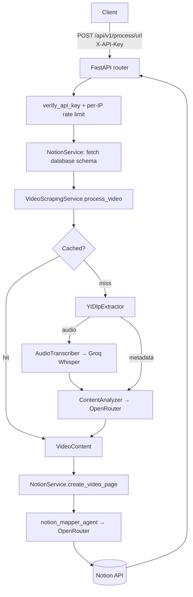
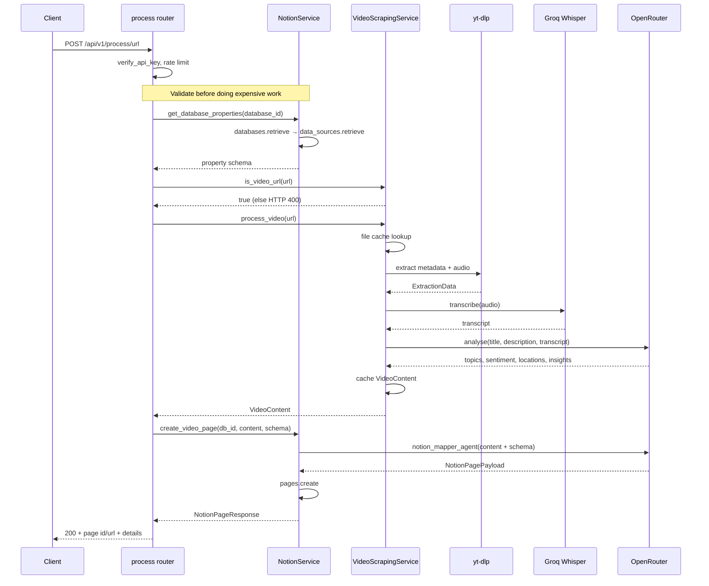

# Architecture

WebToNotion is a FastAPI service that turns a video URL into a structured Notion page.
It has no database of its own — all state is either in-flight, in the file cache, or in Notion.

## Layers

Dependencies flow in one direction only: `api` → `services` → `models` + `config`.
Services and models never import from `api` or `main`.

| Layer | Package | Responsibility |
|---|---|---|
| API | `src/webtonotion/api/` | Routers (`process`, `health`) and middleware |
| DI | `src/webtonotion/dependencies.py` | Settings, service construction, auth, rate limiting |
| Services | `src/webtonotion/services/` | Extraction, analysis, storage, Notion integration |
| Models | `src/webtonotion/models/` | Pydantic models for requests, video content, Notion payloads |
| Config | `src/webtonotion/config/` | `settings.py` (pydantic-settings), `logging.py` (structured logging + Logfire) |

### Service breakdown

```
services/
├── extraction/
│   ├── base.py             VideoExtractor protocol, ExtractionData
│   └── ytdlp_extractor.py  yt-dlp metadata + audio download
├── analysis/
│   ├── transcriber.py      AudioTranscriber — Groq Whisper API
│   ├── content_analyzer.py ContentAnalyzer — PydanticAI agent via OpenRouter
│   └── notion_mapper.py    notion_mapper_agent — VideoContent → Notion payload
├── storage/
│   └── file_cache.py       FileCacheService — JSON cache keyed by URL hash
├── video_scraping_service.py  Orchestrates extract → transcribe → analyse
└── notion_service.py          notion-client wrapper: schema fetch, page creation
```

## High-level flow



## Request sequence



The schema fetch and video-URL check happen **before** extraction, so an unreachable
database or unsupported URL fails in under a second rather than after a download.

## Middleware

Registered in `main.py`; the first added is outermost.

1. `SecurityHeadersMiddleware` — CSP, HSTS, `X-Frame-Options: DENY`, `nosniff`, referrer and permissions policy
2. `ErrorHandlingMiddleware` — adds `X-Request-ID` / `X-Process-Time`, converts unhandled errors
3. `ContentLengthMiddleware` — rejects bodies above `MAX_CONTENT_LENGTH`
4. `RequestLoggingMiddleware` — structured request logs
5. `TrustedHostMiddleware` — restricted to `ALLOWED_HOSTS`
6. `CORSMiddleware` — `*` when `DEBUG=true`, otherwise `ALLOWED_HOSTS`

## Authentication and rate limiting

Both are router-level dependencies on the process router, not per-endpoint decorators:

```python
app.include_router(
    process_router,
    prefix="/api/v1",
    dependencies=[Depends(verify_api_key), Depends(rate_limit_dep)],
)
```

`verify_api_key` compares the `X-API-Key` header against `settings.api_key` with
`secrets.compare_digest`. If no `API_KEY` is configured the service **fails closed** with
HTTP 500 — the API is unusable until a key is set.

Rate limiting is per client IP, held in an in-process dict of `RateLimiter` instances
(`utils/rate_limiter.py`). This is per-worker state: with `WORKERS > 1` the effective limit
is multiplied by the worker count.

The health router is mounted without those dependencies, so `/health/`, `/health/ready`,
`/health/live`, and `/health/notion-health` are open. Only `/health/status` carries its own
`verify_api_key`.

## External dependencies

| Service | Used for | Config |
|---|---|---|
| yt-dlp | Video metadata + audio download | `COOKIES_FILE_PATH`, `MAX_FILE_SIZE`, `MAX_VIDEO_DURATION` |
| Groq | Whisper audio transcription | `WHISPER_API_KEY`, `WHISPER_MODEL` |
| OpenRouter | Content analysis + Notion mapping agents | `OPENROUTER_API_KEY`, `OPENROUTER_MODEL` |
| Notion | Schema fetch + page creation | `NOTION_API_KEY`, `NOTION_VERSION` |
| Logfire | Tracing and structured logs | `LOGFIRE_TOKEN` (optional) |

ffmpeg must be on `PATH` — yt-dlp shells out to it for audio extraction, and `pydub`
uses it to normalise non-mp3 downloads to mono 16 kHz mp3.

## Error translation

`api/process.py` catches by exception type and maps to status codes:

| Exception | Status |
|---|---|
| `VideoScrapingError` | 422 |
| `NotionAuthenticationError` | 401 |
| `NotionAPIError` | 503 |
| `WebToNotionError` | 500 |
| Anything else | 500 (detail suppressed) |

The full hierarchy lives in `src/webtonotion/exceptions.py`, rooted at `WebToNotionError`.

## Design notes

**No automatic database selection.** The client supplies `database_id`. An earlier design
explored semantic search across the workspace to pick a destination database; it was never
built.

**Blocking work must be off the event loop.** yt-dlp, file I/O, and subprocesses are
synchronous. Wrap them with `asyncio.to_thread` rather than calling them directly from an
`async def`.

**Analysis failures degrade, they don't fail.** `ContentAnalyzer.analyze` catches every
exception and returns an empty `ContentAnalysisResult` with neutral sentiment, so a quota
error at the analysis step still produces a Notion page — just a thinner one.

## Related

- [api.md](api.md) — endpoint reference
- [video-processing.md](video-processing.md) — the extraction pipeline in detail
- [notion-integration.md](notion-integration.md) — schema-driven page mapping
- [configuration.md](configuration.md) — every setting
