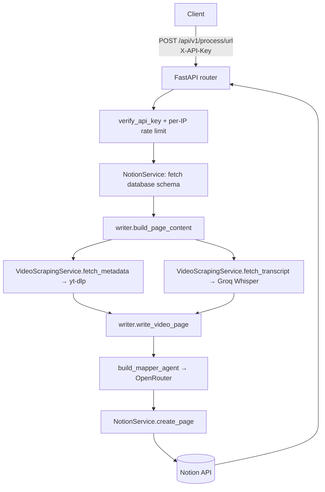
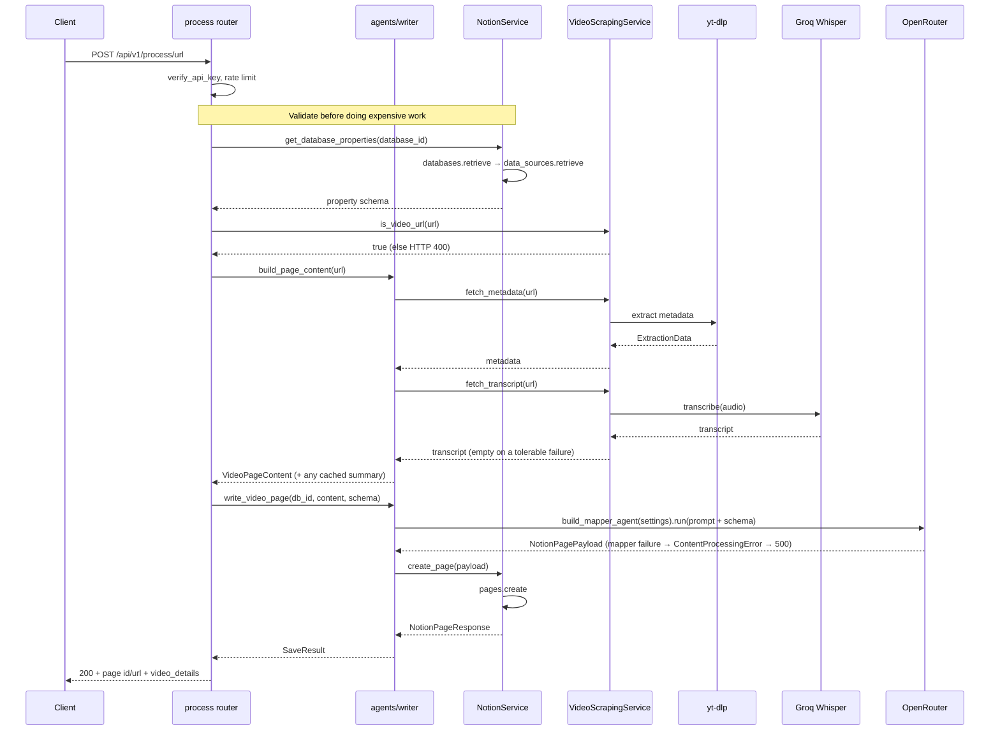
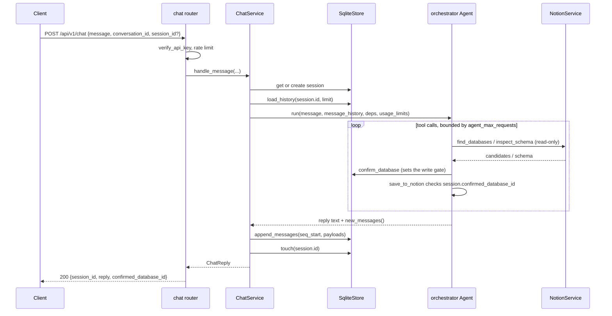

# Architecture

WebToNotion is a FastAPI service that turns a video URL into a structured Notion page.
It has no database of its own — all state is either in-flight, in the file cache, or in Notion.

## Layers

Dependencies flow in one direction only: `api` → `agents` → `services` → `models` + `config`.
Services and models never import from `api`, `agents`, or `main`.

| Layer | Package | Responsibility |
|---|---|---|
| API | `src/webtonotion/api/` | Routers (`process`, `chat`, `health`) and middleware |
| DI | `src/webtonotion/dependencies.py` | Settings, service construction, auth, rate limiting |
| Agents | `src/webtonotion/agents/` | Multi-turn orchestrator, its tools, chat service, session store, and `writer.py` — the shared Notion write path |
| Services | `src/webtonotion/services/` | Extraction, analysis, storage, Notion integration |
| Models | `src/webtonotion/models/` | Pydantic models for requests, video content, Notion payloads, chat |
| Config | `src/webtonotion/config/` | `settings.py` (pydantic-settings), `logging.py` (structured logging + Logfire) |

### Agent breakdown

```
agents/
├── orchestrator.py         build_orchestrator() — the multi-turn chat agent (factory, not
│                            module-level; built once by a DI singleton, never at import)
├── writer.py                build_page_content() + write_video_page() — the single Notion
│                            write path, shared by /process/url and save_to_notion
├── deps.py                  AgentDeps — services + session injected via RunContext
├── capabilities.py          ProcessHistory (history-trim policy) + tool registration
├── chat_service.py          ChatService — one turn: load history, run, persist, reply
├── prompts.py                build_transcript_prompt() — the one cache-stable prompt
│                            builder every sub-agent call goes through
├── subagents.py              Ephemeral summarization/answering sub-agents: escalation,
│                            map-reduce above a size ceiling
├── tools/
│   ├── notion.py             find_databases, inspect_schema, confirm_database, save_to_notion
│   └── video.py              get_video_metadata, get_transcript, summarize, ask_about_video
└── session/
    ├── store.py              SessionStore ABC, Session, SessionConflictError/NotFoundError
    └── sqlite_store.py        SqliteStore — WAL SQLite, append-only messages
```

`save_to_notion` runs the confirm-gate check and then, if the gate is open, calls
`agents/writer.py` (`build_page_content` → `write_video_page`) — the exact same functions
`POST /api/v1/process/url` calls. There is one write path, not two — see the
[design spec](superpowers/specs/2026-08-17-agentic-orchestrator-design.md).

### Sub-agent layer

`get_transcript`, `summarize`, and `ask_about_video` (`tools/video.py`) never
hand a transcript to the orchestrator. `get_transcript` returns a
`TranscriptRef` — a hash, character count, and preview sized for chat context —
and the other two tools start an **ephemeral** sub-agent run, built by a factory
in `subagents.py` (`build_summary_agent` / `build_answer_agent`, never at module
import — constructing an OpenRouter model needs an API key). The transcript body
enters that run and only that run; the run ends when the tool returns a
`SummaryResult` or `AnswerResult`, and nothing about the transcript's contents is
ever appended to the session's persisted message history. This is what keeps a
50k-character transcript from bloating every subsequent turn's context.

Every sub-agent prompt is built by `prompts.build_transcript_prompt`, one
function, deliberately: it produces a stable prefix (a fixed header plus the
transcript/summary/segment-index body) followed by a `CachePoint`, so a
provider's prompt cache can be reused across a video's follow-up questions.
`subagents.py` layers two further cost controls on top of that cache —
escalation (a compact context first, the full transcript only when the sub-agent
reports it was insufficient) and map-reduce above
`SUMMARY_MAP_REDUCE_THRESHOLD_CHARS`. See
[video-processing.md](video-processing.md#prompt-caching) for the mechanics.

### Service breakdown

```
services/
├── extraction/
│   ├── base.py             VideoExtractor protocol, ExtractionData
│   └── ytdlp_extractor.py  yt-dlp metadata + audio download
├── analysis/
│   ├── transcriber.py      AudioTranscriber — Groq Whisper API
│   └── notion_mapper.py    build_mapper_agent(settings) — lazy factory; maps title/
│                           description/summary/transcript onto a Notion payload
├── storage/
│   └── file_cache.py       FileCacheService — JSON cache keyed by URL hash
├── video_scraping_service.py  is_video_url, fetch_metadata, fetch_transcript, store_summary
└── notion_service.py          pure notion-client wrapper: get_databases, create_page,
                               get_database_properties, health_check
```

`content_analyzer.py` is gone. The `topics` / `sentiment` / `locations` extraction step it
performed was removed, not replaced — the mapper agent now infers Notion properties directly
from the title, description, any cached summary, and the transcript excerpt.

## High-level flow



The chat `save_to_notion` tool enters this same graph at `writer.build_page_content` once
the session's write gate is open.

## Request sequence



The schema fetch and video-URL check happen **before** extraction, so an unreachable
database or unsupported URL fails in under a second rather than after a download.

## Chat sequence



The write gate is a single column, `sessions.confirmed_database_id`. `save_to_notion`
reads it directly rather than trusting the system prompt to have remembered a rule,
which is also the prompt-injection defense: untrusted video text in the model's
context cannot talk it past a check on server-held state.

### Streaming variant

`POST /api/v1/chat/stream` (`ChatService.stream_message`) runs the identical
turn through `agent.run_stream_events` instead of `agent.run`, emitting a
`session` event immediately and then a `tool_call`/`tool_return`/`thinking`/`text`
event as each one occurs, instead of returning silently until the whole turn
finishes. Once the run completes, `stream_message` calls the exact same
`ChatService._persist_turn` that `handle_message` calls — there is one
persistence path, not two, so the write-gate rollback on a lost session-conflict
race and the `ChatReply`/`trace` construction behave identically regardless of
which route a client used. The persisted result is then re-emitted once more, in
full, as the terminal `reply` event.

## Middleware

Registered in `main.py`; the first added is outermost.

1. `SecurityHeadersMiddleware` — CSP, HSTS, `X-Frame-Options: DENY`, `nosniff`, referrer and permissions policy
2. `ErrorHandlingMiddleware` — adds `X-Request-ID` / `X-Process-Time`, converts unhandled errors
3. `ContentLengthMiddleware` — rejects bodies above `MAX_CONTENT_LENGTH`
4. `RequestLoggingMiddleware` — structured request logs
5. `TrustedHostMiddleware` — restricted to `ALLOWED_HOSTS`
6. `CORSMiddleware` — `*` when `DEBUG=true`, otherwise `ALLOWED_HOSTS`

## Authentication and rate limiting

Both are router-level dependencies, attached at inclusion rather than per-endpoint
decorators. The chat router follows the exact same pattern as the process router:

```python
app.include_router(
    process_router,
    prefix="/api/v1",
    dependencies=[Depends(verify_api_key), Depends(rate_limit_dep)],
)
app.include_router(
    chat_router,
    prefix="/api/v1",
    dependencies=[Depends(verify_api_key), Depends(rate_limit_dep)],
)
```

`verify_api_key` compares the `X-API-Key` header against `settings.api_key` with
`secrets.compare_digest`. If no `API_KEY` is configured the service **fails closed** with
HTTP 500 — the API is unusable until a key is set.

Rate limiting is per client IP, held in an in-process dict of `RateLimiter` instances
(`utils/rate_limiter.py`). This is per-worker state: with `WORKERS > 1` the effective limit
is multiplied by the worker count.

The health router is mounted without those dependencies, so `/health/`, `/health/ready`,
`/health/live`, and `/health/notion-health` are open. Only `/health/status` carries its own
`verify_api_key`.

## External dependencies

| Service | Used for | Config |
|---|---|---|
| yt-dlp | Video metadata + audio download (fast/full profiles — see [video-processing.md](video-processing.md#fast-and-full-profiles)) | `COOKIES_FILE_PATH`, `MAX_FILE_SIZE`, `MAX_VIDEO_DURATION`, `AUDIO_QUALITY` |
| Groq | Whisper audio transcription | `WHISPER_API_KEY`, `WHISPER_MODEL` |
| OpenRouter | Notion mapping and the chat orchestrator / sub-agents | `OPENROUTER_API_KEY`, `OPENROUTER_MODEL` |
| Notion | Schema fetch + page creation | `NOTION_API_KEY`, `NOTION_VERSION` |
| Logfire | Tracing and structured logs | `LOGFIRE_TOKEN` (optional) |

ffmpeg must be on `PATH` — yt-dlp shells out to it for audio extraction, and `pydub`
uses it to normalise non-mp3 downloads to mono 16 kHz mp3.

## Error translation

`api/process.py` catches by exception type and maps to status codes:

| Exception | Status |
|---|---|
| `VideoScrapingError` | 422 |
| `NotionAuthenticationError` | 401 |
| `NotionAPIError` | 503 |
| `ContentProcessingError` (mapper failure) | 500 |
| `WebToNotionError` | 500 |
| Anything else | 500 (detail suppressed) |

`ContentProcessingError` is an `AIAgentError` → `WebToNotionError`, so it lands on the 500
branch. A Notion-mapping failure used to surface as a misleading 503 (it went through
`NotionService`); routing the write through `agents/writer.py` makes it a 500, which is what
a model-side failure actually is.

`api/chat.py` follows the same style, plus two errors specific to the session store
(`src/webtonotion/agents/session/store.py`), raised by `ChatService` and never seen
outside it:

| Exception | Status |
|---|---|
| `SessionNotFoundError` | 404 |
| `SessionConflictError` | 409 |
| `NotionAuthenticationError` | 401 |
| `NotionAPIError` | 503 |
| `WebToNotionError` | 500 |
| Anything else | 500 (detail suppressed) |

The full hierarchy lives in `src/webtonotion/exceptions.py`, rooted at `WebToNotionError`.

## Design notes

**No automatic database selection.** The client supplies `database_id`. An earlier design
explored semantic search across the workspace to pick a destination database; it was never
built.

**Blocking work must be off the event loop.** yt-dlp, file I/O, and subprocesses are
synchronous. Wrap them with `asyncio.to_thread` rather than calling them directly from an
`async def`.

**One write path, no separate analysis pass.** There is no `ContentAnalyzer` and no
`topics`/`sentiment`/`locations` extraction step. `agents/writer.py` assembles a
`VideoPageContent` (metadata + a transcript excerpt + any summary already cached by the chat
tools) and the Notion mapper agent infers the target database's properties from that
directly. Both `/process/url` and the chat `save_to_notion` tool call
`build_page_content` + `write_video_page` — the write is defined once.

**Mapper failures are typed, not silent.** `write_video_page` wraps a mapper-agent failure
(model error, retry exhaustion) as `ContentProcessingError`, which the `/process/url` handler
maps to HTTP 500. The video tools' `summarize`/`ask_about_video` catch the same error class
and return a `ToolError` the orchestrator can explain instead of aborting the turn.

## Related

- [api.md](api.md) — endpoint reference
- [video-processing.md](video-processing.md) — the extraction pipeline in detail
- [notion-integration.md](notion-integration.md) — schema-driven page mapping
- [configuration.md](configuration.md) — every setting
