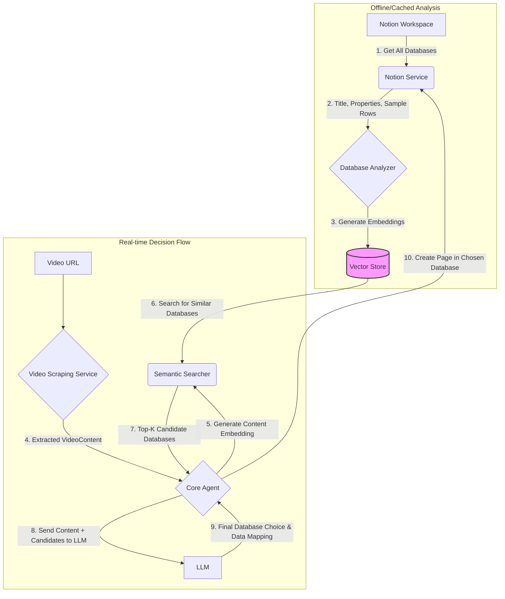

### **Database Selection Architecture**

**1. Overview**

To ensure that video content is saved to the most relevant Notion database, the agent will use a sophisticated, two-step process that combines semantic search with LLM-based final decision-making. This approach is designed to be scalable, accurate, and cost-effective, especially for users with a large number of Notion databases.

The core principle is to first intelligently filter the list of all available databases to a small set of relevant candidates and then use a focused LLM prompt to make the final selection.

**2. Architectural Flow**

The process can be broken down into two main phases: an offline/cached "Database Analysis" phase and a real-time "Decision" phase.

**3. Phase 1: Database Analysis & Caching (Offline)**

This phase runs periodically or on-demand to create a searchable index of the user's Notion databases.

*   **1. Fetch Databases**: The `NotionService` retrieves a list of all databases accessible to the integration.
*   **2. Analyze Schema and Content**: For each database, a `DatabaseAnalyzer` component will extract key textual information:
    *   The database's **title** and **description**.
    *   The names and types of its **properties** (e.g., "Destination," "Date," "Recipe Name").
    *   **Sample Data**: It will fetch a small number of rows (e.g., 3-5) from the database to understand the *actual content* it holds. This provides a much richer semantic context than schema alone.
*   **3. Generate & Cache Embeddings**: A single text document is created from the analyzed information for each database. A sentence-transformer model then generates a vector embedding from this text. This embedding, which numerically represents the "meaning" of the database, is stored in a simple vector store (e.g., FAISS, in-memory NumPy array) mapped to the database ID.

**4. Phase 2: Decision Flow (Real-time)**

This phase executes every time a new video URL is processed.

*   **4. Extract Video Content**: The `VideoScrapingService` processes the URL and returns a structured `VideoContent` object containing metadata, the transcript, and AI-generated topics or keywords.
*   **5. Generate Content Embedding**: The `CoreAgent` creates a concise summary of the video content and generates a vector embedding for it using the same model from Phase 1.
*   **6. Semantic Search**: The agent performs a vector similarity search, comparing the video content's embedding against the cached database embeddings.
*   **7. Candidate Selection**: The search returns a ranked list of the top `k` (e.g., 3) most semantically similar database IDs. These are the *candidate databases*.
*   **8. LLM Final Decision**: The agent now invokes the LLM with a highly focused and efficient prompt, including:
    *   The summarized video content.
    *   The names and properties of *only the candidate databases*.
    *   A clear instruction to choose the single best database from the provided list and map the video data to its properties.
*   **9. Create Notion Page**: With the final database ID and the mapped data, the agent calls the `NotionService` to create the page.

**5. Benefits of this Approach**

*   **Scalability**: The system handles hundreds of databases without a significant increase in LLM prompt size or cost. The initial semantic search is extremely fast.
*   **Accuracy**: The decision is based on the semantic meaning of both the video content and the actual data within the databases, not just their titles. This leads to more reliable and consistent routing.
*   **Cost-Effectiveness**: By sending only a few candidate databases to the LLM, we drastically reduce the number of tokens used for each decision.
*   **Flexibility**: The `DatabaseAnalyzer` can be enhanced to include more sophisticated logic (e.g., weighting properties differently) without changing the core decision flow.

**6. Implementation Details**

*   A new component, `DatabaseAnalyzer`, will be created within the `services` module.
*   The `CoreAgent` in `core/agent.py` will be updated to implement the two-step decision logic.
*   A lightweight vector search library (e.g., `faiss-cpu` or `scikit-learn`) will be added to the project dependencies.