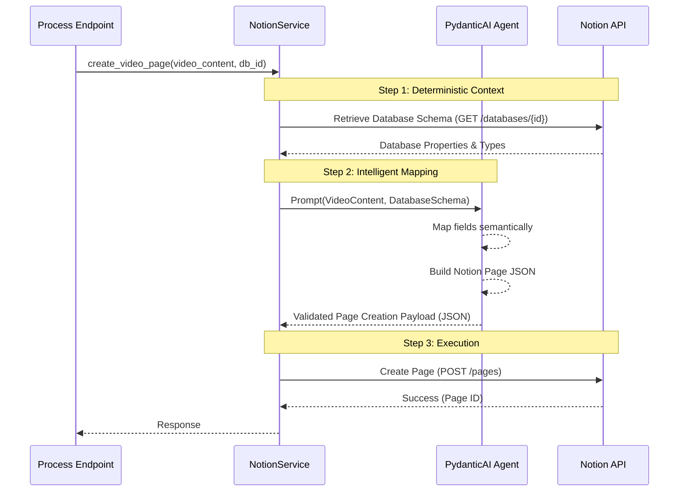

# Hybrid AI-Driven Notion Page Creation

This document outlines the architectural approach for the "Hybrid" Notion integration in WebToNotion. This approach combines deterministic API interactions with AI-driven semantic mapping to create robust, flexible Notion pages from video content.

## The Concept

The core challenge is mapping structured video data (title, transcript, sentiment, etc.) to **user-defined** Notion databases where property names and types may vary wildly (e.g., "URL" vs "Link", "Author" vs "Presenter").

The **Hybrid Approach** solves this by:
1.  **Deterministic Schema Fetching**: Using the official Notion API to get the exact database structure.
2.  **AI-Driven Mapping**: Using a PydanticAI Agent to intelligently map content to that schema.
3.  **Schema-Driven Generation**: The AI generates strictly valid Notion API JSON based on the injected schema.

## Architecture Workflow

## Core Components

### 1. Schema-Driven JSON Generation
Instead of maintaining rigid Pydantic models for every possible Notion block variation, we leverage the AI's ability to generate valid JSON that strictly adheres to the fetched database schema. This provides flexibility while maintaining structure.

### 2. The Mapping Agent (`src/webtonotion/services/analysis/notion_mapper.py`)
A specialized PydanticAI Agent responsible for the translation logic.

*   **Input**: `VideoContent` object, `DatabaseSchema` (dict).
*   **System Prompt**: "You are an expert Notion API integrator. Map the provided video content to the database schema. If a property like 'Sentiment' exists in the schema but not in the video object, infer it from the transcript."
*   **Output**: Clean JSON payload representing the Notion Page.

### 3. Service Integration (`src/webtonotion/services/notion_service.py`)
The service orchestrates the flow:
1.  Fetches schema via `get_database_properties`.
2.  Calls the Agent.
3.  Cleans and validates the JSON.
4.  Creates the page.

## Implementation Steps

### Phase 1: Foundations (Type Safety)
*   [x] **Create Block Models**: *Replaced by Schema-Driven JSON Generation strategy.*
*   [x] **Create Property Models**: *Handled dynamically via Database Schema injection.*

### Phase 2: The Agent (Intelligence)
*   [x] **Define Agent Interface**: Create `src/webtonotion/services/analysis/notion_mapper.py`.
*   [x] **Design System Prompt**: Craft a prompt that explains how to handle missing fields, type conversions (e.g., `float` duration to `string` text), and formatting.
*   [x] **Implement Agent Logic**: Use `pydantic-ai` to wire the `VideoContent` + `Schema` -> `JSON Payload`.

### Phase 3: Integration (Execution)
*   [x] **Refactor NotionService**: 
    *   Add method `get_database_properties(db_id)`.
    *   Inject `NotionMapperAgent` into `NotionService`.
    *   Update `create_video_page` to use the agent flow.
*   [ ] **Testing**: Verify that the AI correctly handles:
    *   Databases with weird column names.
    *   Databases missing standard columns.
    *   Type mismatches (fixing them automatically).

## Benefits
*   **Resilience**: Works with *any* user database structure without code changes.
*   **Quality**: The AI can format the page content (e.g., summarize the transcript into a bulleted list) better than a static template.
*   **Maintainability**: Logic is centralized in the Agent prompt rather than complex mapping code.
